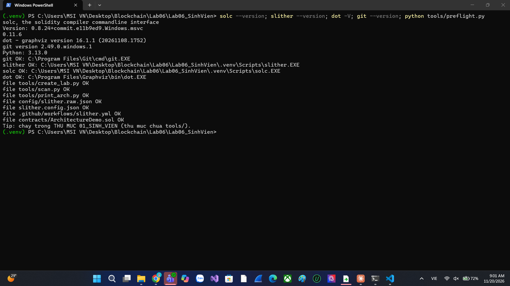
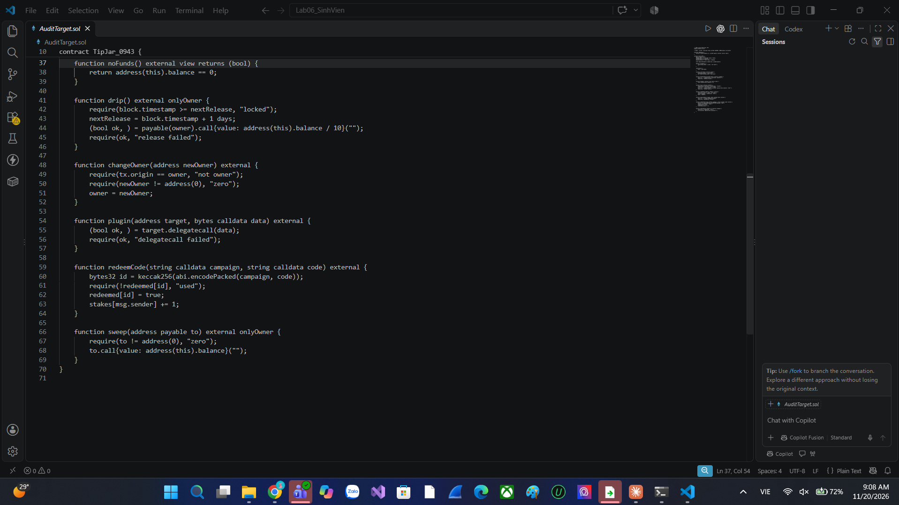
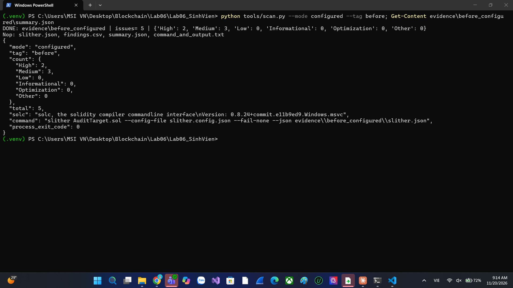
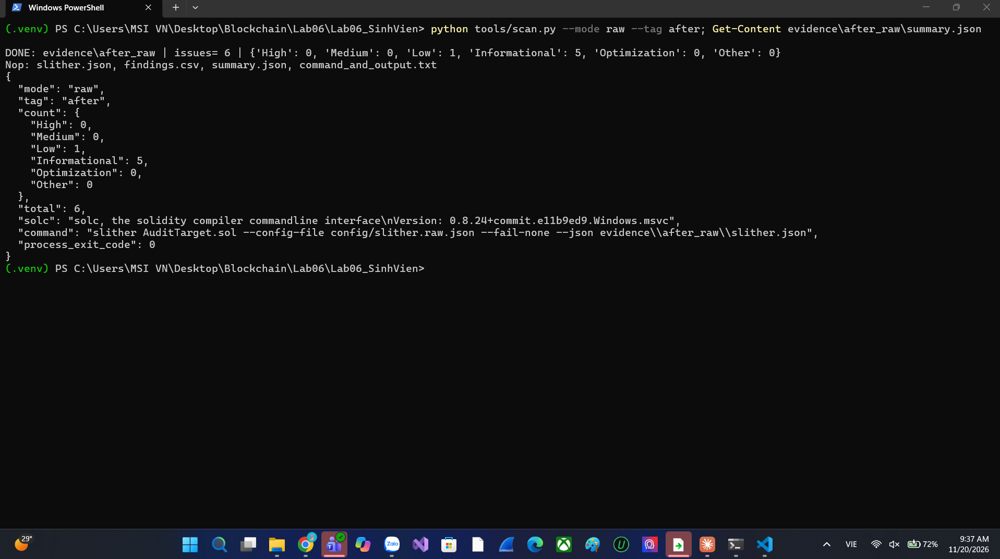
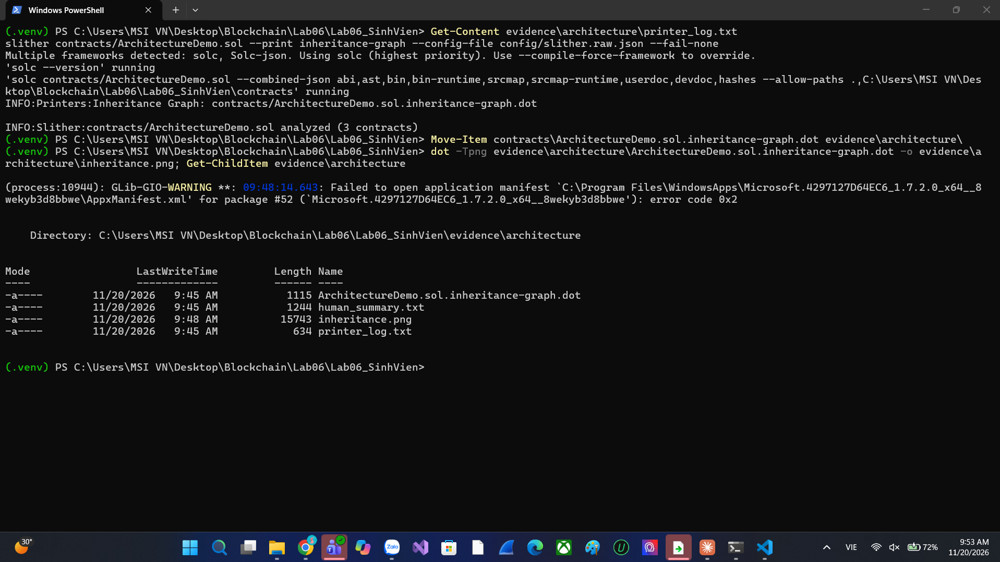
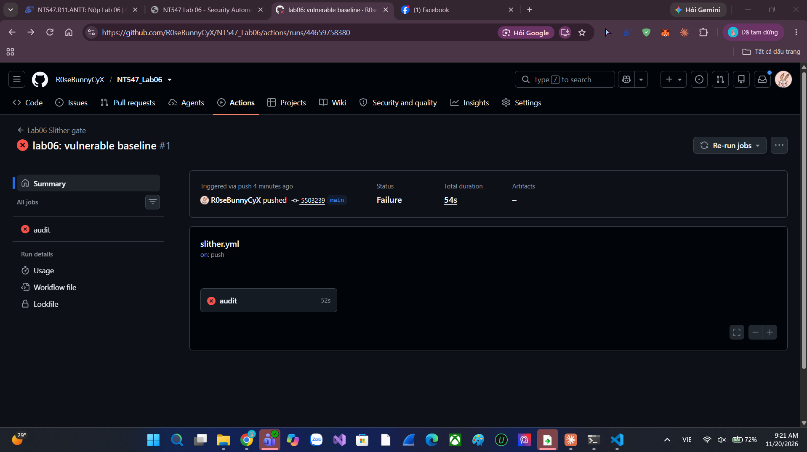
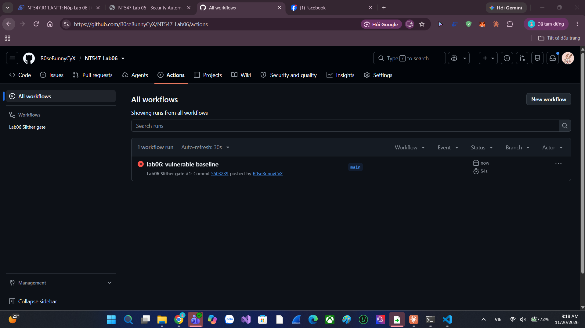
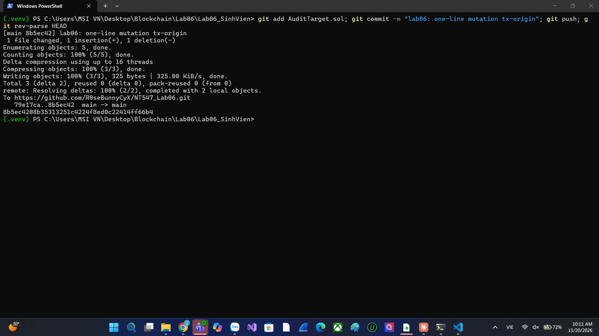
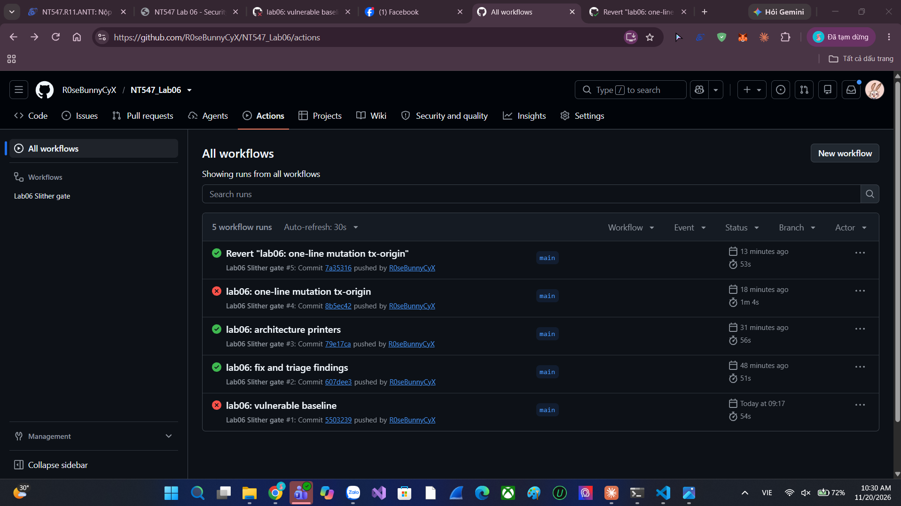

# NT547 – LAB 06 – BÁO CÁO: SECURITY AUTOMATION & CI/CD

| Thông tin | Giá trị |
|---|---|
| MSSV | 24520943 |
| Họ tên | Lâm Tú Lan |
| Lớp | NT547.R11.ANTT.1 |
| Session code | SC-FD5CB7 |
| Tên contract | TipJar_0943 |
| Phiên bản Solidity | 0.8.24 |
| Phiên bản Slither | 0.11.6 |
| Hệ điều hành | Windows 11 (PowerShell) |
| Python | 3.13.0 |
| Ngày hoàn thành | 20/11/2026 |
| URL GitHub repository | https://github.com/R0seBunnyCyX/NT547_Lab06 |

---

## 0. Chuẩn bị môi trường và tạo mục tiêu cá nhân

Em làm bài trực tiếp trên Windows bằng PowerShell, không dùng WSL2. Đầu tiên em tạo môi trường ảo bằng `python -m venv .venv`, kích hoạt bằng `.\.venv\Scripts\Activate.ps1`, cài thư viện bằng `python -m pip install -r requirements.txt`, sau đó chạy `solc-select install 0.8.24` và `solc-select use 0.8.24`. Lúc đầu terminal vẫn nhận solc bản khác, nên em phải chạy lại hai lệnh `solc-select` sau khi đã kích hoạt `.venv` thì mới đúng 0.8.24. Graphviz em cài riêng và tự thêm `C:\Program Files\Graphviz\bin` vào PATH vì bộ cài không tự thêm.

Khi kiểm tra lại, em có đủ solc `0.8.24+commit.e11b9ed9`, Slither `0.11.6`, Graphviz `16.1.1`, git `2.49.0` và Python 3.13.0. Script `tools/preflight.py` báo OK cho tất cả công cụ và tệp cần thiết.

*Hình 1. Kiểm tra phiên bản các công cụ và chạy `preflight.py`, tất cả đều OK.*

Tiếp theo em chạy `python tools/create_lab.py 24520943` để sinh contract riêng theo MSSV. Script tạo ra `AuditTarget.sol` với contract `TipJar_0943` và file `lab_identity.json`, trong đó session code của em là `SC-FD5CB7` và mã băm baseline là `95ef7a941b99d6527b3238836c2dc1b35228c7d64775ff38dabdfe0c79e98014`.

*Hình 2. Sinh contract `TipJar_0943` và `lab_identity.json` từ MSSV 24520943.*

*Hình 3. Mã nguồn baseline, dòng 1 đến 45 (`onlyOwner`, `ownerWithdraw`, `noFunds`, `drip`).*

*Hình 4. Phần còn lại của mã nguồn baseline (`changeOwner`, `plugin`, `redeemCode`, `sweep`).*

---

## 1. Nhiệm vụ 1 – Static scan (2,0 điểm)

### 1.1. Lệnh và số lượng finding

Em quét hai lần: một lần không lọc (raw) để thấy toàn bộ cảnh báo, một lần dùng `slither.config.json` (configured) để xem cấu hình lọc bớt những gì. Số liệu dưới đây em lấy từ file `summary.json` của từng lần quét.

| Chế độ | Lệnh | High | Medium | Low | Informational | Optimization | Tổng |
|---|---|---|---|---|---|---|---|
| raw (before) | `python tools/scan.py --mode raw --tag before` | 2 | 3 | 2 | 5 | 0 | 12 |
| configured (before) | `python tools/scan.py --mode configured --tag before` | 2 | 3 | 0 | 0 | 0 | 5 |

*Hình 5. Quét raw trước khi sửa: 12 finding (2 High, 3 Medium, 2 Low, 5 Informational).*

*Hình 6. Quét configured trước khi sửa: còn 5 finding (2 High, 3 Medium).*

*Hình 7. Nội dung `findings.csv` của lần quét raw: tên detector, mức độ, độ tin cậy và số dòng.*

So sánh hai lần quét, em thấy cấu hình chỉ ẩn những cảnh báo nhẹ. `slither.config.json` bật `exclude_low`, `exclude_informational` và tắt detector `solc-version`, nên 2 cảnh báo Low (`missing-zero-check`, `timestamp`) và 5 cảnh báo Informational (4 `low-level-calls`, 1 `naming-convention`) biến mất, tổng giảm từ 12 xuống 5. Còn 2 High và 3 Medium thì vẫn nguyên. Nói cách khác, cấu hình chỉ giúp đỡ rối mắt chứ không che được lỗi nghiêm trọng.

Mỗi thư mục `evidence/before_raw/` và `evidence/before_configured/` có đủ 4 file `slither.json`, `findings.csv`, `summary.json` và `command_and_output.txt`. Lệnh quét trả về exit code 0 là do có tham số `--fail-none`, điều này không có nghĩa là contract an toàn.

### 1.2. Các detector khác nhau và luồng dữ liệu

Kết quả có 5 detector khác nhau. Với mỗi cái, em đọc lại code để mô tả lỗi xảy ra như thế nào chứ không chép mô tả của tool.

| ID | Detector | Impact | Confidence | Vị trí (file:hàm:dòng) | Luồng dữ liệu (đầu vào → xử lý → hậu quả) |
|---|---|---|---|---|---|
| F01 | controlled-delegatecall | High | Medium | AuditTarget.sol:`plugin(address,bytes)`:54-57, lệnh ở dòng 55 | Ai cũng gọi được `plugin` và tự chọn `target` lẫn `data`. Hàm dùng `delegatecall` nên code của kẻ tấn công chạy trên storage của TipJar, có thể ghi đè `owner` rồi rút hết ETH. |
| F02 | tx-origin | Medium | Medium | AuditTarget.sol:`changeOwner(address)`:48-52, lệnh ở dòng 49 | Nếu owner bị lừa gọi vào một contract độc hại, contract đó gọi tiếp `changeOwner(attacker)`. Lúc này `tx.origin` vẫn là owner nên kiểm tra vẫn qua, và quyền sở hữu rơi vào tay kẻ tấn công. |
| F03 | encode-packed-collision | High | High | AuditTarget.sol:`redeemCode(string,string)`:59-64, lệnh ở dòng 60 | Hai chuỗi có độ dài thay đổi được nối liền nhau, nên `"ab"+"c"` và `"a"+"bc"` cho cùng một id. Mã của chiến dịch này có thể bị đánh dấu đã dùng ở chiến dịch khác, làm người dùng hợp lệ không đổi được mã. |
| F04 | unchecked-lowlevel | Medium | Medium | AuditTarget.sol:`sweep(address)`:66-69, lệnh ở dòng 68 | Owner gọi `sweep(to)` mà địa chỉ `to` từ chối nhận ETH thì `call` trả về `false`, nhưng code không kiểm tra. Giao dịch vẫn báo thành công dù tiền chưa chuyển. |
| F05 | incorrect-equality | Medium | High | AuditTarget.sol:`noFunds()`:37-39, lệnh ở dòng 38 | Ai đó có thể ép ETH vào contract (qua `selfdestruct` hoặc phần thưởng block), khi đó `balance == 0` không bao giờ đúng nữa. Hậu quả chỉ là hàm hiển thị sai (em phân tích kỹ ở phần triage). |

---

## 2. Nhiệm vụ 2 – Triage và sửa lỗi (2,5 điểm)

### 2.1. Bảng triage

Em đọc toàn bộ `AuditTarget.sol` và xác định được 4 lỗi thật cần sửa cùng 2 đoạn cần đánh giá theo ngữ cảnh. Với từng cảnh báo, em xem hàm đó ai gọi được, cần quyền gì và có thay đổi state hay chuyển tiền không.

| # | Detector và vị trí | Phân loại | Lý do em đưa ra kết luận | Cách xử lý | Sau khi sửa |
|---|---|---|---|---|---|
| 1 | controlled-delegatecall – `plugin` (dòng 55) | **TP** | Hàm `external`, không có modifier nên ai cũng gọi được, lại tự chọn địa chỉ đích. `delegatecall` chạy trên storage của TipJar nên chiếm được `owner` và rút được ETH. | Thêm `onlyOwner`, bỏ tham số `target`, chỉ cho `delegatecall` tới biến `module` do owner đặt qua hàm `setModule` (cũng `onlyOwner` và bắt buộc là contract). Rủi ro còn lại là phải tin owner chọn module đúng, phần này em chấp nhận và đặt suppression đúng một dòng. | Không còn cảnh báo |
| 2 | tx-origin – `changeOwner` (dòng 49) | **TP** | Đây là hàm đổi chủ sở hữu, quyền cao nhất của contract. Dùng `tx.origin` thì có thể bị lừa qua một contract trung gian. | Đổi thành `require(msg.sender == owner, "not owner")` và thêm event `OwnerChanged`. | Không còn cảnh báo |
| 3 | encode-packed-collision – `redeemCode` (dòng 60) | **TP** | Hai tham số `string` có độ dài thay đổi, ai cũng gọi được, nên các cặp (campaign, code) khác nhau có thể ra cùng một id. | Đổi sang `abi.encode(campaign, code)`, vì cách mã hoá này có ghi độ dài nên không bị trùng. | Không còn cảnh báo |
| 4 | unchecked-lowlevel – `sweep` (dòng 68) | **TP** (rủi ro thấp vì chỉ owner gọi) | Hàm có `onlyOwner`, nhưng kết quả của `call` bị bỏ qua nên nếu chuyển tiền thất bại thì không ai biết. | Lưu kết quả vào `ok` và thêm `require(ok, "sweep failed")`. | Không còn cảnh báo |
| 5 | incorrect-equality – `noFunds` (dòng 38) | **Chấp nhận theo ngữ cảnh** | Đây là hàm `view`, không hàm nào khác gọi tới, không dùng để cấp quyền hay chuyển tiền. Nếu có sai thì chỉ sai giá trị hiển thị. | Giữ nguyên logic, đặt `// slither-disable-next-line incorrect-equality` ngay trước dòng `return`, kèm comment giải thích. | Không còn cảnh báo |
| 6 | timestamp – `drip` (dòng 42) | **Chấp nhận theo ngữ cảnh** (Low) | Hàm chỉ owner gọi được. `block.timestamp` chỉ dùng để khoá 1 ngày, validator có lệch vài giây cũng không ảnh hưởng. `nextRelease` đã được cập nhật trước khi chuyển tiền. | Không sửa code và không cần suppression, vì đây là mức Low và đã bị lọc ở chế độ configured. | Còn 1 Low trong raw |

Ngoài ra còn vài cảnh báo phụ:
- `missing-zero-check` (Low) ở tham số `target` của `plugin` tự hết sau khi em bỏ tham số này.
- `low-level-calls` (Informational, 4 chỗ) em giữ nguyên, vì dùng `.call` là cách được khuyến nghị để gửi ETH và mọi chỗ đều đã kiểm tra `ok`.
- `naming-convention` (Informational) báo tên contract `TipJar_0943` không đúng quy ước, nhưng tên này do script sinh theo MSSV nên em giữ nguyên cho khớp với `lab_identity.json`.
- Ở bản baseline, cả 4 lỗi thật và 2 đoạn ngữ cảnh đều được Slither báo, nên em không phải ghi "Manual review, Not reported" cho mẫu nào. Tuy vậy ở Nhiệm vụ 5 em gặp một trường hợp Slither bỏ sót: `tx.origin` đặt trong modifier thì không bị báo.

### 2.2. Kịch bản khai thác lỗi controlled-delegatecall

Giả sử có một kẻ tấn công bất kỳ. Vì `plugin` là hàm `external` và không kiểm tra quyền, kẻ đó chỉ cần deploy một contract `Evil` có hàm `pwn()` ghi `msg.sender` vào slot 0, mà slot 0 của TipJar chính là biến `owner`. Sau đó kẻ tấn công gọi `plugin(Evil, abi.encodeWithSignature("pwn()"))`. Do `delegatecall` chạy code của `Evil` trên storage của TipJar, kẻ tấn công trở thành `owner`, rồi gọi `ownerWithdraw` hoặc `sweep` để rút hết số ETH mà người dùng đã gửi qua `contribute`.

Nếu `Evil` dùng `selfdestruct` thì cần lưu ý: từ bản nâng cấp Cancun (EIP-6780), lệnh này thường chỉ chuyển hết ETH đi chứ không xoá code hay storage, trừ khi contract được tạo và huỷ trong cùng một giao dịch.

### 2.3. Cảnh báo mức cao nhưng rủi ro thực tế thấp

Slither xếp `incorrect-equality` ở hàm `noFunds()` vào mức Medium với độ tin cậy High. Nhưng khi đọc code, em thấy đây chỉ là một hàm `view`, không ghi state, và không có hàm nào trong contract dựa vào kết quả của nó để cấp quyền hay chuyển tiền. Nếu ai đó ép ETH vào thì hàm chỉ trả về `false` sai, tức là sai ở phần hiển thị chứ không có cách nào lợi dụng để lấy tài sản. Vì vậy em chấp nhận cảnh báo này, dùng suppression đúng tên detector và đúng dòng, kèm comment giải thích ngay trong code.

### 2.4. Diff và kết quả quét sau khi sửa

Các thay đổi trong code được xem bằng lệnh `git diff -- AuditTarget.sol`:

*Hình 8. Diff phần 1: thêm biến `module`, event `OwnerChanged`, suppression ở `noFunds`, đổi `tx.origin` thành `msg.sender` trong `changeOwner`.*

*Hình 9. Diff phần 2: thêm `setModule`, sửa `plugin`, đổi `redeemCode` sang `abi.encode`, kiểm tra kết quả `call` trong `sweep`.*

Sau khi sửa, em quét lại cả hai chế độ:

| Chế độ | High | Medium | Low | Informational | Tổng |
|---|---|---|---|---|---|
| raw before | 2 | 3 | 2 | 5 | 12 |
| raw after | 0 | 0 | 1 | 5 | 6 |
| configured before | 2 | 3 | 0 | 0 | 5 |
| configured after | 0 | 0 | 0 | 0 | 0 |

*Hình 10. Quét raw sau khi sửa: còn 6 finding, không có High hay Medium.*

*Hình 11. Quét configured sau khi sửa: 0 finding.*

Ở chế độ raw vẫn còn 6 cảnh báo: 1 Low là `timestamp` ở `drip`, và 5 Informational gồm 4 `low-level-calls` (ở `ownerWithdraw`, `drip`, `plugin`, `sweep`) cùng 1 `naming-convention` cho tên contract. Em đã giải thích tất cả ở phần 2.1, và không còn cảnh báo High hay Medium nào.

### 2.5. Lý do cho từng `slither-disable-next-line`

Em chỉ dùng hai suppression, mỗi cái đặt ngay trên dòng bị báo:

| Vị trí | Detector | Lý do | Biện pháp bù lại |
|---|---|---|---|
| Comment ở dòng 40, áp dụng cho dòng 41 (`noFunds`) | incorrect-equality | Hàm chỉ dùng để hiển thị, không ảnh hưởng tới quyền hay tiền. | Không hàm nào gọi `noFunds`, và hàm không ghi state. |
| Comment ở dòng 67, áp dụng cho dòng 68 (`plugin`) | controlled-delegatecall | Địa chỉ đích giờ là `module` do owner cấu hình, người gọi không tự truyền vào được nữa. | Cả `plugin` và `setModule` đều có `onlyOwner` (kiểm tra bằng `msg.sender`), và `setModule` bắt buộc địa chỉ phải là contract. |

Em không bật `exclude_high` hay `exclude_medium`, cũng không tắt hẳn detector nào.

---

## 3. Nhiệm vụ 3 – Kiến trúc và Inheritance (1,5 điểm)

Em chạy `python tools/print_arch.py`, script này gọi hai printer `human-summary` và `inheritance-graph` trên file `contracts/ArchitectureDemo.sol`. Kết quả được lưu trong `evidence/architecture/`, gồm `human_summary.txt`, `ArchitectureDemo.sol.inheritance-graph.dot`, `inheritance.png` và `printer_log.txt`.

Ở bước này em gặp một lỗi nhỏ. Printer vẫn chạy thành công (trong `printer_log.txt` có dòng `INFO:Printers:Inheritance Graph: contracts/ArchitectureDemo.sol.inheritance-graph.dot`), nhưng script lại báo "Khong tim thay *.dot". Nguyên nhân là script tìm file tên `ArchitectureDemo.sol.dot`, trong khi Slither 0.11.6 đặt tên là `ArchitectureDemo.sol.inheritance-graph.dot`. Em chuyển file `.dot` vào `evidence/architecture/` rồi tự render ảnh theo đúng cách trong mục 6 của hướng dẫn: `dot -Tpng evidence/architecture/ArchitectureDemo.sol.inheritance-graph.dot -o evidence/architecture/inheritance.png`.

*Hình 12. Chạy `print_arch.py`: printer đã tạo file `.dot` nhưng script không tìm thấy vì khác tên.*

*Hình 13. Chuyển file `.dot` vào thư mục evidence và tự render `inheritance.png` bằng Graphviz.*

*Hình 14. Kết quả `human-summary`: 3 contract, 23 dòng code, không có lỗi High, Medium hay Low.*

*Hình 15. Đồ thị kế thừa đã đánh dấu: (A) `StudentAsset` là entrypoint, (B) `AccessManaged` quản lý quyền, (C) `BalanceLedger` quản lý số dư.*

Theo human summary, file có 3 contract, 23 dòng code, không có assembly, không có lỗi High, Medium, Low hay Informational, chỉ có 1 gợi ý Optimization. `StudentAsset` có 4 hàm (tính cả hàm kế thừa) và không theo chuẩn ERC nào.

Nhìn vào đồ thị, `StudentAsset` kế thừa (1) `AccessManaged` rồi đến (2) `BalanceLedger`, đúng thứ tự trong khai báo `is AccessManaged, BalanceLedger`. Từ đó em xác định:
- **Quản lý quyền:** `AccessManaged`, gồm biến `admin` và modifier `onlyAdmin`.
- **Quản lý số dư:** `BalanceLedger`, gồm `mapping balances`, hàm public `balanceOf` và hàm internal `_credit`.
- **Contract triển khai và được gọi từ bên ngoài:** `StudentAsset`, với entrypoint là `mint`.

**Phân tích:** Phần logic quan trọng về bảo mật nằm ở hai contract cha. `AccessManaged` quyết định ai được làm gì thông qua `onlyAdmin` (so sánh `msg.sender` với `admin`), còn `BalanceLedger` là nơi số dư thực sự bị thay đổi qua `_credit`. Hàm duy nhất thay đổi state là `StudentAsset.mint(to, amount)`, nơi kết hợp kiểm tra quyền với việc ghi số dư. Vì vậy em sẽ bắt đầu audit từ `mint` rồi lần ngược lên các contract cha, bởi một lỗi trong modifier hay hàm internal của contract cha sẽ ảnh hưởng tới mọi contract con mà khi chỉ đọc contract con thì rất khó thấy. Những điểm em sẽ kiểm tra thêm là `admin` có được gán đúng trong constructor không, có hàm đổi admin nào thiếu bảo vệ không, và `_credit` có bị gọi từ chỗ nào khác ngoài `mint` không.

---

## 4. Nhiệm vụ 4 – Red → Green CI (2,5 điểm)

Workflow `.github/workflows/slither.yml` dùng `crytic/slither-action@v0.4.2` với solc 0.8.24, Slither 0.11.6, cấu hình `slither.config.json` và ngưỡng `fail-on: medium`. Em push bản baseline ngay sau Nhiệm vụ 1, trước khi sửa code, để có lần chạy RED hợp lệ.

| Lần chạy | Commit SHA | Run URL | Kết quả | Lý do |
|---|---|---|---|---|
| Baseline có lỗi | `5503239b5902aa7f1c2484b4fcde701859e7606a` (5503239) | https://github.com/R0seBunnyCyX/NT547_Lab06/actions/runs/44659758380 | RED | Slither báo 5 lỗi: 2 High (controlled-delegatecall, encode-packed-collision) và 3 Medium (incorrect-equality, tx-origin, unchecked-lowlevel), vượt ngưỡng `fail-on: medium`. |
| Sau khi sửa | `607dee358444f77024d5f19ac8c19e6e2ac9f384` (607dee3) | https://github.com/R0seBunnyCyX/NT547_Lab06/actions/runs/44662693268 | GREEN | Đã sửa 4 lỗi thật, 2 cảnh báo ngữ cảnh được chấp nhận bằng suppression đúng dòng, không còn High hay Medium. |

*Hình 16. Commit và push bản baseline có lỗi (commit 5503239).*

*Hình 17. Run #1 của bản baseline báo Failure (RED).*

*Hình 18. Trang Actions sau lần push đầu tiên, run baseline bị đánh dấu ✗.*

*Hình 19. Log của run #1: Slither tìm thấy 5 lỗi High và Medium nên job thất bại.*

*Hình 20. Commit và push bản đã sửa (commit 607dee3).*

*Hình 21. Run #2 của bản đã sửa báo Success (GREEN).*

*Hình 22. Log của run #2: `0 result(s) found`.*

**Khác nhau giữa `--fail-none` ở local và `fail-on: medium` trên CI:** Khi chạy ở máy, `--fail-none` làm Slither luôn trả exit code 0 để script lưu đủ file JSON và CSV làm bằng chứng, kể cả khi có lỗi High. Trên CI thì ngược lại, `fail-on: medium` biến Slither thành một cổng kiểm tra chất lượng: chỉ cần còn một lỗi Medium hoặc High (sau khi đã áp cấu hình và suppression) là job thất bại và commit bị đánh dấu ✗.

**Tác dụng của `exclude_low` và `exclude_informational`:** Hai tuỳ chọn này ẩn các cảnh báo Low và Informational khỏi kết quả configured và CI, ở bản baseline là từ 12 xuống còn 5. Chúng giúp kết quả gọn hơn, nhưng không đụng tới High và Medium, nên không thể dùng để "lách" cho CI xanh.

---

## 5. Nhiệm vụ 5 – Mutation RED → GREEN (1,5 điểm)

### 5.1. Thử mutation trong `modifier onlyOwner` như hướng dẫn

Đầu tiên em làm đúng theo hướng dẫn: đổi dòng `require(msg.sender == owner, "not owner");` trong `modifier onlyOwner` thành `tx.origin`, rồi quét thử ở máy bằng `python tools/scan.py --mode configured --tag mutation_modifier`. Kết quả bất ngờ là `issues= 0`, file `evidence/mutation_modifier_configured/summary.json` ghi `"total": 0`, tức Slither hoàn toàn không phát hiện ra.

*Hình 23. Đổi `msg.sender` thành `tx.origin` trong modifier nhưng Slither báo 0 kết quả.*

Em tìm hiểu thêm và thấy detector `tx-origin` của Slither 0.11.6 (file `slither/detectors/statements/tx_origin.py`) chỉ duyệt các hàm trong `contract.functions` mà không duyệt modifier, nên `tx.origin` nằm trong modifier bị bỏ sót. Đây là một trường hợp false negative, và nó cho thấy công cụ phân tích tĩnh không thay được việc đọc code thủ công. Nếu commit thay đổi này thì CI sẽ vẫn xanh, không đạt yêu cầu RED, nên em không commit mà hoàn tác bằng `git checkout -- AuditTarget.sol`.

### 5.2. Mutation một dòng được commit

Để có lần chạy RED đúng nghĩa, em áp dụng cùng thay đổi đó lên dòng kiểm tra quyền trong hàm `changeOwner`: đổi `require(msg.sender == owner, "not owner");` thành `require(tx.origin == owner, "not owner");`. Chỉ đúng một dòng thay đổi, các dòng khác giữ nguyên.

Lần này quét ở máy ra `issues= 1`: một lỗi `tx-origin` mức Medium, độ tin cậy Medium, trong hàm `changeOwner` (dòng 51-56), câu lệnh lỗi ở dòng 52. Trên CI, run #4 cũng thất bại (RED) vì đúng lỗi `tx-origin` này vượt ngưỡng `fail-on: medium`. Khi commit, em chỉ `git add AuditTarget.sol` để commit mutation đúng một dòng.

*Hình 24. Diff chỉ đổi một dòng trong `changeOwner`, quét ở máy ra 1 lỗi `tx-origin` ở dòng 52.*

*Hình 25. Commit và push mutation (commit 8b5ec42).*

*Hình 26. Run #4 của mutation báo Failure (RED).*

*Hình 27. Log của run #4: `Detector: tx-origin`, `uses tx.origin for authorization`, 1 kết quả.*

Sau đó em hoàn tác mutation bằng một commit mới với lệnh `git revert --no-edit HEAD` rồi push.

*Hình 28. Revert mutation (commit 7a35316), `git log` cho thấy đủ 5 commit.*

*Hình 29. Run #5 sau khi revert báo Success (GREEN).*

| Lần chạy | Commit SHA | Run URL | Kết quả |
|---|---|---|---|
| Mutation | `8b5ec4208b35313251c4224f8ed0c22414ff66b4` (8b5ec42) | https://github.com/R0seBunnyCyX/NT547_Lab06/actions/runs/44666134112 | RED (tx-origin) |
| Revert mutation | `7a35316824ec2c9fd843397d049d1d7c5d7c660a` (7a35316) | https://github.com/R0seBunnyCyX/NT547_Lab06/actions/runs/44666733372 | GREEN |

**Vì sao đổi `msg.sender` thành `tx.origin` lại nguy hiểm:** `msg.sender` là địa chỉ gọi trực tiếp vào hàm, còn `tx.origin` là ví (EOA) đã khởi tạo cả giao dịch. Khi kiểm tra bằng `tx.origin`, nếu owner bị dụ tương tác với một contract độc hại, contract đó có thể gọi tiếp `changeOwner(attacker)` và vẫn qua được kiểm tra vì `tx.origin` vẫn là owner, thế là mất quyền sở hữu. Chỉ một dòng thay đổi đã đủ làm CI chuyển đỏ, chứng tỏ pipeline bắt được lỗi bảo mật bị đưa ngược vào code. Sau khi `git revert`, code trở về bản an toàn và CI xanh lại.

### 5.3. Toàn bộ chuỗi RED → GREEN → RED → GREEN

| # | Giai đoạn | SHA | Run URL | Kết quả |
|---|---|---|---|---|
| 1 | Baseline | `5503239b5902aa7f1c2484b4fcde701859e7606a` (5503239) | https://github.com/R0seBunnyCyX/NT547_Lab06/actions/runs/44659758380 | RED |
| 2 | Fix | `607dee358444f77024d5f19ac8c19e6e2ac9f384` (607dee3) | https://github.com/R0seBunnyCyX/NT547_Lab06/actions/runs/44662693268 | GREEN |
| 3 | Mutation | `8b5ec4208b35313251c4224f8ed0c22414ff66b4` (8b5ec42) | https://github.com/R0seBunnyCyX/NT547_Lab06/actions/runs/44666134112 | RED |
| 4 | Revert | `7a35316824ec2c9fd843397d049d1d7c5d7c660a` (7a35316) | https://github.com/R0seBunnyCyX/NT547_Lab06/actions/runs/44666733372 | GREEN |

Giữa bước 2 và bước 3 còn một run #3 (commit `79e17ca`, kết quả printers của Nhiệm vụ 3). Commit này không sửa `AuditTarget.sol` nên CI vẫn xanh, không ảnh hưởng tới chuỗi trên.

*Hình 30. Trang Actions với đủ 5 run: #1 ✗, #2 ✓, #3 ✓, #4 ✗, #5 ✓.*

---

## 6. Bằng chứng và tự kiểm tra

*Hình 31. Chạy `package_submission.py` để tạo file nộp `submissions/NT547_Lab06_24520943.zip`.*

- [x] `AuditTarget.sol`, `lab_identity.json`
- [x] `evidence/before_raw/` và `evidence/before_configured/`
- [x] `evidence/after_raw/` và `evidence/after_configured/`
- [x] `evidence/architecture/` (human_summary.txt, file .dot, inheritance.png)
- [x] Bằng chứng mutation: `evidence/mutation_configured/`, `evidence/mutation_modifier_configured/`
- [x] Đã revert mutation, nhánh `main` đang xanh (run #5)
- [x] 4 URL Actions run theo thứ tự RED → GREEN → RED → GREEN và 4 commit SHA
- [x] Link repo, ảnh chụp có đủ terminal, URL và commit SHA, không cắt mất ngữ cảnh
- [x] Các cảnh báo đều được triage bằng phân tích riêng, không chép mô tả của detector
- [x] Không có seed phrase, private key hay thông tin đăng nhập nào
- [x] File nộp: `submissions/NT547_Lab06_24520943.zip`

**Nhận xét cuối cùng:** Qua bài lab này, em thấy Slither tìm ra 5 lỗi High và Medium trong `TipJar_0943` rất nhanh, và khi gắn vào GitHub Actions với `fail-on: medium` thì nó trở thành một cổng kiểm tra tự động: bản có lỗi bị chặn (RED), bản đã sửa thì qua (GREEN). File cấu hình chỉ giúp ẩn bớt cảnh báo nhẹ chứ không che được lỗi nghiêm trọng, nên muốn CI xanh thì bắt buộc phải sửa code hoặc giải thích rõ lý do khi chấp nhận một cảnh báo. Em cố gắng dùng ít suppression nhất có thể, và chỗ nào dùng cũng có giải thích cùng biện pháp bù lại. Thí nghiệm mutation cho thấy pipeline phát hiện ngay khi một dòng kiểm tra quyền bị đổi sang `tx.origin`, và `git revert` đưa mọi thứ về trạng thái an toàn. Điều em bất ngờ nhất là cùng thay đổi đó đặt trong modifier thì Slither lại bỏ sót. Vì vậy em nghĩ Slither nên được dùng như một lớp kiểm tra bổ sung, đi kèm với việc đọc code thủ công và viết test, chứ không thể thay thế hoàn toàn.
