# NT547 – LAB 06 – BÁO CÁO: SECURITY AUTOMATION & CI/CD

| Thông tin | Giá trị |
|---|---|
| MSSV | 24520943 |
| Họ tên | ____ |
| Lớp | ____ |
| Session code | SC-FD5CB7 |
| Tên contract | TipJar_0943 |
| Solidity / Slither | 0.8.24 / 0.11.6 |
| Hệ điều hành / Python | Windows 11 – PowerShell / Python ____ |
| Ngày hoàn thành | ____ |
| URL GitHub repository | https://github.com/R0seBunnyCyX/NT547_Lab06 |

> Ghi chú cách điền: thay mọi chỗ `____` bằng số liệu thật; ảnh đặt trong `evidence/screenshots/` đúng tên. Các đoạn phân tích bên dưới là bản nháp — đọc lại, đối chiếu với output máy mình và chỉnh theo hiểu biết của bản thân.

---

## 0. Chuẩn bị môi trường & tạo mục tiêu cá nhân

- Lệnh cài đặt: `python -m venv .venv` → `.\.venv\Scripts\Activate.ps1` → `python -m pip install -r requirements.txt` → `solc-select install 0.8.24` → `solc-select use 0.8.24` → `python tools/preflight.py`.
- Kết quả: solc `____`, Slither `____`, Graphviz `____`, preflight: ____.

- Lệnh tạo target: `python tools/create_lab.py 24520943`
- `lab_identity.json`: session_code `SC-FD5CB7`, baseline_sha256 `95ef7a941b99d6527b3238836c2dc1b35228c7d64775ff38dabdfe0c79e98014`.

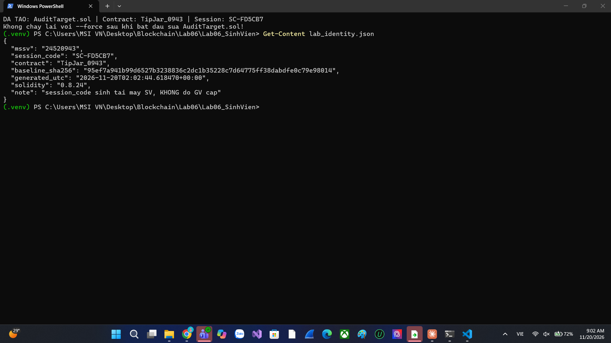

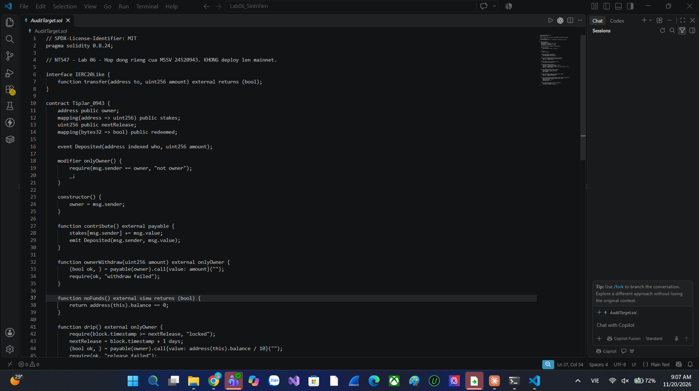

---

## 1. Nhiệm vụ 1 – Static scan (2,0 điểm)

### 1.1. Lệnh và số lượng finding

| Chế độ | Lệnh | High | Medium | Low | Informational | Optimization | Tổng |
|---|---|---|---|---|---|---|---|
| raw (before) | `python tools/scan.py --mode raw --tag before` | 2 | 3 | 2 | 5 | 0 | 12 |
| configured (before) | `python tools/scan.py --mode configured --tag before` | 2 | 3 | 0 | 0 | 0 | 5 |

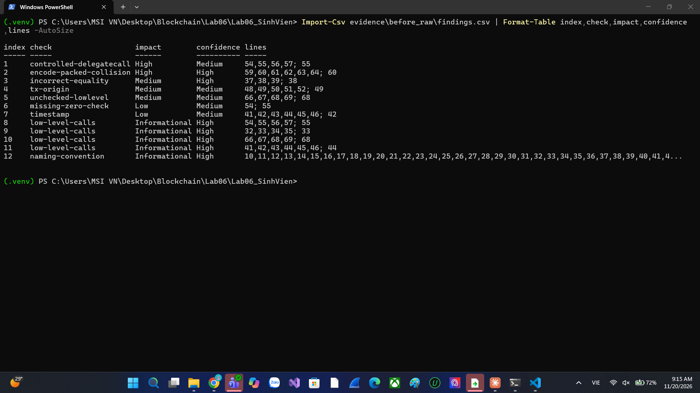

**So sánh raw / configured:** `slither.config.json` bật `exclude_low`, `exclude_informational` và loại detector `solc-version`, nên bản configured chỉ ẩn 2 finding Low (`missing-zero-check`, `timestamp`) và 5 finding Informational (4 `low-level-calls`, 1 `naming-convention`); tổng giảm từ 12 xuống 5. Số High/Medium **không đổi** (2 High, 3 Medium) — config chỉ giảm nhiễu hiển thị, không làm biến mất lỗi nghiêm trọng.

**Evidence:** `evidence/before_raw/` và `evidence/before_configured/` mỗi thư mục có `slither.json`, `findings.csv`, `summary.json`, `command_and_output.txt`. Exit code của lệnh scan = 0 do `--fail-none`, **không** có nghĩa contract an toàn.

### 1.2. Ba detector khác tên và luồng dữ liệu

| ID | Detector | Impact | Confidence | Vị trí (file:hàm:dòng) | Luồng dữ liệu: đầu vào → thao tác → tác hại |
|---|---|---|---|---|---|
| F01 | controlled-delegatecall | High | Medium | AuditTarget.sol:`plugin(address,bytes)`:54-57 (lệnh ở dòng 55) | Bất kỳ ai truyền `target` + `data` tuỳ ý → `target.delegatecall(data)` chạy code của kẻ tấn công trong ngữ cảnh storage của TipJar → ghi đè slot `owner` / chuyển toàn bộ ETH đi. |
| F02 | tx-origin | Medium | Medium | AuditTarget.sol:`changeOwner(address)`:48-52 (lệnh ở dòng 49) | Owner bị dụ gọi một contract độc hại → contract đó gọi `changeOwner(attacker)`, `tx.origin` vẫn là owner nên check qua → quyền sở hữu bị chuyển cho kẻ tấn công. |
| F03 | encode-packed-collision | High | High | AuditTarget.sol:`redeemCode(string,string)`:59-64 (lệnh ở dòng 60) | Hai chuỗi động nối liền nhau (`"ab"+"c"` = `"a"+"bc"`) → `keccak256(abi.encodePacked(...))` trùng id → mã của chiến dịch này bị đánh dấu "used" ở chiến dịch khác / chặn người dùng hợp lệ. |
| F04 (thêm) | unchecked-lowlevel | Medium | Medium | AuditTarget.sol:`sweep(address)`:66-69 (lệnh ở dòng 68) | Owner gọi `sweep(to)` với `to` từ chối nhận ETH → `call` trả `false` nhưng bị bỏ qua → giao dịch báo thành công giả, sai lệch kế toán/off-chain. |
| F05 (thêm) | incorrect-equality | Medium | High | AuditTarget.sol:`noFunds()`:37-39 (lệnh ở dòng 38) | Ai đó ép ETH vào (selfdestruct/coinbase) → `balance == 0` không bao giờ đúng → chỉ sai giá trị hiển thị (xem triage). |

---

## 2. Nhiệm vụ 2 – Triage và sửa lỗi (2,5 điểm)

### 2.1. Bảng triage (4 mẫu lỗi thật + 2 đoạn ngữ cảnh)

| # | Detector + vị trí | Phân loại | Bằng chứng (đường gọi, quyền, state) | Biện pháp | Sau sửa |
|---|---|---|---|---|---|
| 1 | controlled-delegatecall – `plugin` (dòng 55) | **TP** | `external`, không modifier → ai cũng gọi; `target` do caller chọn; delegatecall dùng storage của TipJar → chiếm `owner`, rút ETH. | Fix: thêm `onlyOwner`; bỏ tham số `target`, chỉ delegatecall tới `module` do owner đặt qua `setModule` (onlyOwner, phải là contract). Phần rủi ro còn lại (tin tưởng owner) **accepted** bằng `// slither-disable-next-line controlled-delegatecall` đúng 1 dòng. | Hết (suppression đúng dòng) |
| 2 | tx-origin – `changeOwner` (dòng 49) | **TP** | Hàm đổi `owner` — thao tác quyền cao nhất; dùng `tx.origin` nên bị phishing qua contract trung gian. | Fix: `require(msg.sender == owner, "not owner")` + emit `OwnerChanged`. | Hết (0 trong raw & configured) |
| 3 | encode-packed-collision – `redeemCode` (dòng 60) | **TP** | Hai tham số `string` động, ai cũng gọi được; id bị trùng giữa các cặp (campaign, code) khác nhau. | Fix: `abi.encode(campaign, code)` (có độ dài/padding). | Hết (0 trong raw & configured) |
| 4 | unchecked-lowlevel – `sweep` (dòng 68) | **TP** (mức thấp, chỉ owner) | `onlyOwner`, nhưng kết quả `call` bị bỏ qua → thất bại im lặng. | Fix: `(bool ok, ) = to.call{...}(""); require(ok, "sweep failed");` | Hết (0 trong raw & configured) |
| 5 | incorrect-equality – `noFunds` (dòng 38) | **Accepted / contextual** | Hàm `view`, không được hàm nào khác gọi, không dùng để cấp quyền hay chuyển tiền; sai lệch chỉ ảnh hưởng hiển thị. | Accept: `// slither-disable-next-line incorrect-equality` ngay trước `return`, kèm comment lý do. | Hết (suppression đúng dòng) |
| 6 | timestamp – `drip` (dòng 42) | **Accepted / contextual** (Low) | `onlyOwner`; timestamp chỉ dùng cho khoá 1 ngày, độ lệch vài giây của validator không đáng kể; đã cập nhật `nextRelease` trước external call (CEI). | Accept, không sửa code; không suppression (Low, đã bị lọc ở configured). | Còn trong raw (Low) |

Các finding phụ:
- `missing-zero-check` (Low) ở `plugin.target` → tự hết vì đã bỏ tham số `target`.
- `low-level-calls` (Info, 4 chỗ) → accepted: `.call` là cách khuyến nghị để gửi ETH, đã kiểm tra `ok` ở mọi chỗ.
- `naming-convention` (Info) → accepted: tên `TipJar_0943` do generator sinh theo MSSV, giữ nguyên để khớp `lab_identity.json`.
- Mẫu nào Slither không báo: ____ (nếu có, ghi "Manual review / Not reported").

### 2.2. Kịch bản khai thác TP (controlled-delegatecall)

Người gọi: kẻ tấn công bất kỳ → Điều kiện: `plugin` là `external` và không kiểm tra quyền → Call/state: kẻ tấn công deploy contract `Evil` có hàm `pwn()` ghi `slot0 = msg.sender` (slot 0 của TipJar là `owner`) rồi gọi `plugin(Evil, abi.encodeWithSignature("pwn()"))` → delegatecall chạy `pwn()` trên storage của TipJar → Hậu quả: kẻ tấn công thành `owner`, sau đó gọi `ownerWithdraw`/`sweep` rút toàn bộ ETH người dùng đã `contribute`. (Nếu `Evil` chứa `selfdestruct`: sau Cancun/EIP-6780 lệnh này chỉ chuyển toàn bộ ETH đi, không xoá code/storage, trừ khi trong cùng giao dịch tạo contract.)

### 2.3. Finding severity cao nhưng rủi ro thực tế thấp

`incorrect-equality` được Slither xếp **Medium / High confidence** ở `noFunds()`. Tuy vậy đây là hàm `view`, không ghi state, không có hàm nào trong contract dựa vào kết quả của nó để cấp quyền hay chuyển tiền. Việc ETH bị ép vào chỉ làm hàm trả `false` sai — ảnh hưởng hiển thị, không có đường khai thác tài sản. Vì vậy phân loại accepted, dùng suppression đúng detector + đúng dòng, có comment giải thích trong mã.

### 2.4. Diff và scan sau sửa

- Lệnh: `git diff -- AuditTarget.sol`

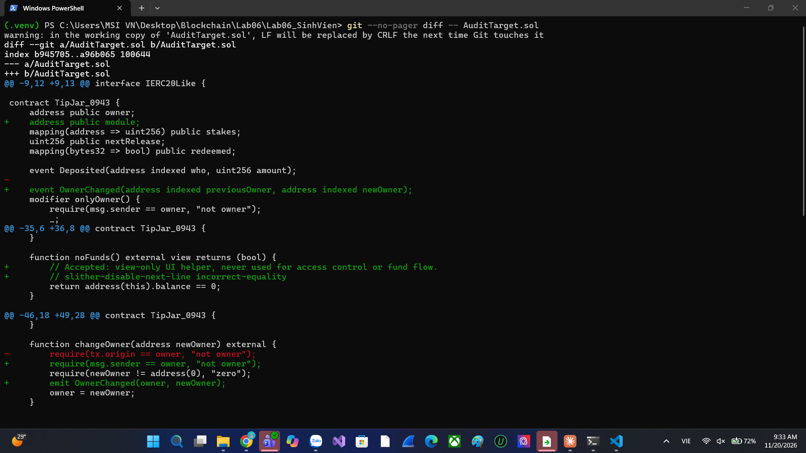

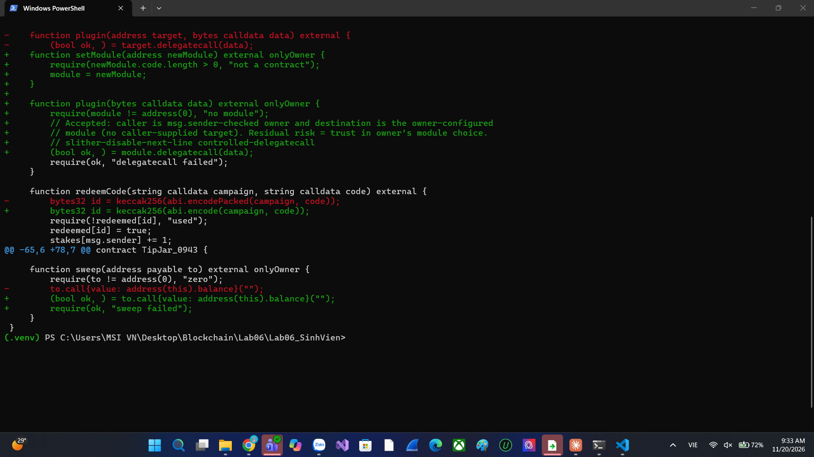

| Chế độ | High | Medium | Low | Informational | Tổng |
|---|---|---|---|---|---|
| raw before | 2 | 3 | 2 | 5 | 12 |
| raw after | 0 | 0 | 1 | 5 | 6 |
| configured before | 2 | 3 | 0 | 0 | 5 |
| configured after | 0 | 0 | 0 | 0 | 0 |

**Cảnh báo còn lại sau sửa (raw):** 6 finding = 1 Low (`timestamp` ở `drip`) + 5 Informational (4 `low-level-calls` ở `ownerWithdraw`, `drip`, `plugin`, `sweep`; 1 `naming-convention` tên contract) → tất cả đã giải thích ở bảng 2.1, không có High/Medium.

### 2.5. Lý do của mọi `slither-disable-next-line`

| Dòng | Detector | Lý do | Kiểm soát bù trừ |
|---|---|---|---|
| ____ (`noFunds`) | incorrect-equality | Hàm view chỉ hiển thị, không tham gia quyết định quyền/tiền. | Không hàm nào gọi `noFunds`; không ghi state. |
| ____ (`plugin`) | controlled-delegatecall | Đích là `module` do owner cấu hình, không còn do caller truyền vào. | `plugin` và `setModule` đều `onlyOwner` (msg.sender); `setModule` bắt buộc địa chỉ là contract. |

Không dùng `exclude_high`, `exclude_medium`, không tắt cả detector.

---

## 3. Nhiệm vụ 3 – Kiến trúc / Inheritance (1,5 điểm)

- Lệnh: `python tools/print_arch.py` (chạy printer `human-summary` và `inheritance-graph` trên `contracts/ArchitectureDemo.sol`).
- Ghi chú sự cố: printer chạy thành công (`printer_log.txt`: `INFO:Printers:Inheritance Graph: contracts/ArchitectureDemo.sol.inheritance-graph.dot`) nhưng script báo "Khong tim thay *.dot" vì nó tìm tên `ArchitectureDemo.sol.dot`, trong khi Slither 0.11.6 xuất `ArchitectureDemo.sol.inheritance-graph.dot`. Đã chuyển file `.dot` vào `evidence/architecture/` và render thủ công theo mục 6 của hướng dẫn: `dot -Tpng evidence/architecture/ArchitectureDemo.sol.inheritance-graph.dot -o evidence/architecture/inheritance.png`.

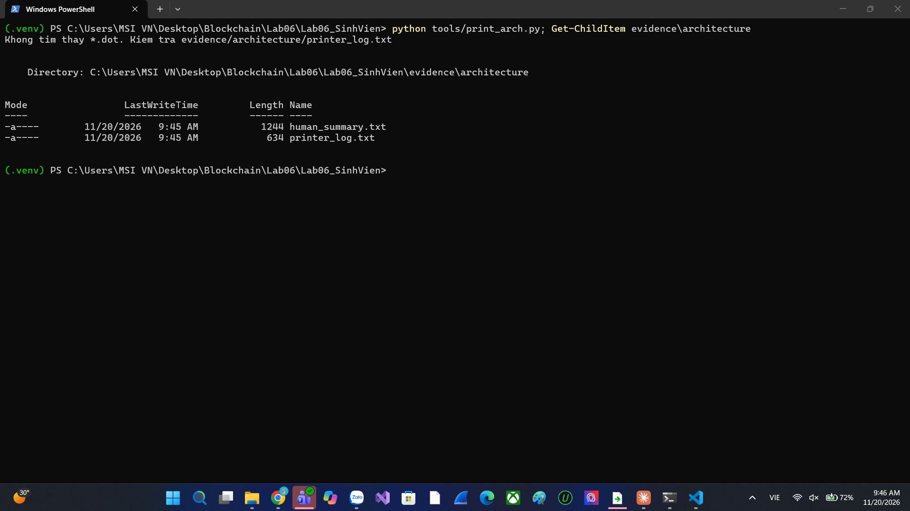

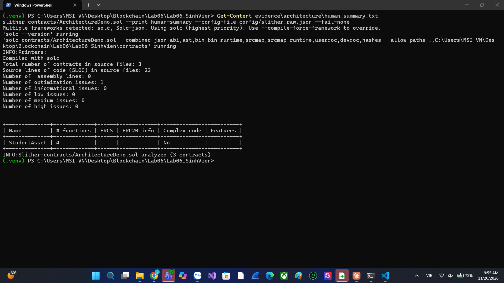

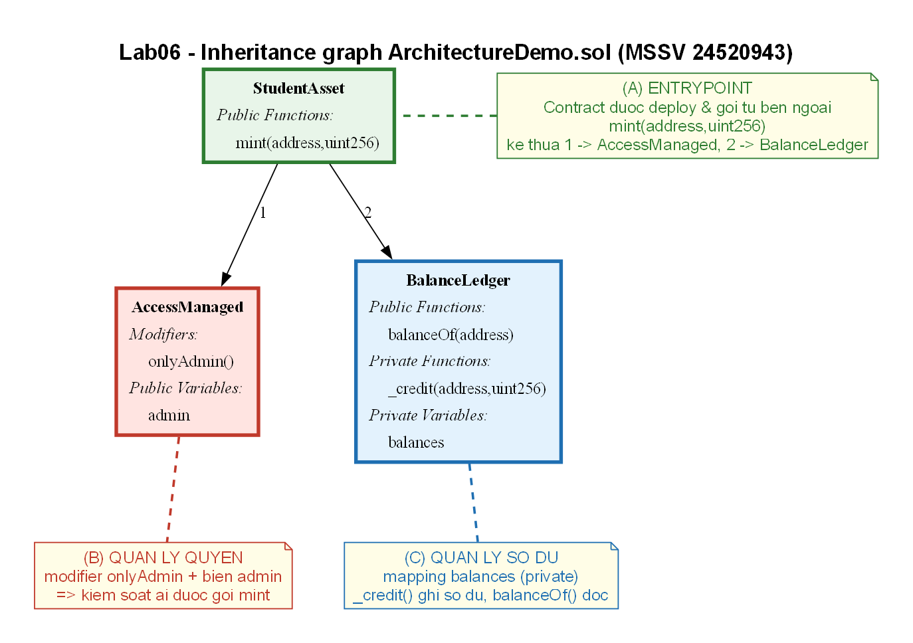

- **Access control** nằm ở `AccessManaged` (biến `admin`, modifier `onlyAdmin`).
- **Logic số dư** nằm ở `BalanceLedger` (`mapping balances`, `balanceOf`, `_credit`).
- **Contract triển khai / được gọi từ bên ngoài** là `StudentAsset` (kế thừa cả hai, entrypoint `mint`).
- Thông tin từ human summary: 3 contract, 23 SLOC, 0 dòng assembly; 0 High / 0 Medium / 0 Low / 0 Informational, 1 Optimization; `StudentAsset` có 4 hàm (gồm hàm kế thừa), không có code phức tạp, không theo chuẩn ERC nào.
- Đồ thị kế thừa: `StudentAsset` → (1) `AccessManaged` (modifier `onlyAdmin()`, biến public `admin`) và (2) `BalanceLedger` (public `balanceOf(address)`, private/internal `_credit(address,uint256)`, biến `balances`). Thứ tự 1, 2 trên cạnh là thứ tự kế thừa `is AccessManaged, BalanceLedger`.

**Phân tích (3–5 câu):** Logic security-critical nằm ở hai contract cha: `AccessManaged` quyết định ai được phép (`onlyAdmin` dựa trên `msg.sender == admin`) và `BalanceLedger` thay đổi số dư qua hàm internal `_credit`. Entrypoint duy nhất làm thay đổi state là `StudentAsset.mint(to, amount)`, nơi ghép quyền (`onlyAdmin`) với ghi số dư (`_credit`). Audit nên bắt đầu từ `mint` rồi lần theo đồ thị kế thừa lên các contract cha, vì một lỗi ở modifier hay hàm internal của cha sẽ ảnh hưởng mọi contract con mà không hiện rõ khi chỉ đọc contract con. Cần kiểm tra thêm: `admin` được gán đúng trong constructor, không có hàm đổi admin thiếu bảo vệ, và `_credit` không bị gọi từ đường nào khác ngoài `mint`.

---

## 4. Nhiệm vụ 4 – Red → Green CI (2,5 điểm)

Workflow `.github/workflows/slither.yml`: `crytic/slither-action@v0.4.2`, solc 0.8.24, Slither 0.11.6, `slither-config: slither.config.json`, `fail-on: medium`.

| Phase | Commit SHA | Run URL | Kết quả | Detector khiến RED / lý do GREEN |
|---|---|---|---|---|
| Baseline vulnerable | `5503239b5902aa7f1c2484b4fcde701859e7606a` (5503239) | https://github.com/R0seBunnyCyX/NT547_Lab06/actions/runs/44659758380 | RED | Slither (configured) báo 5 result: controlled-delegatecall, encode-packed-collision (High); incorrect-equality, tx-origin, unchecked-lowlevel (Medium) → vượt ngưỡng `fail-on: medium` |
| Patched | `607dee358444f77024d5f19ac8c19e6e2ac9f384` (607dee3) | https://github.com/R0seBunnyCyX/NT547_Lab06/actions/runs/44662693268 | GREEN | Đã sửa 4 TP, 2 finding ngữ cảnh accepted bằng suppression đúng dòng → 0 High/Medium |

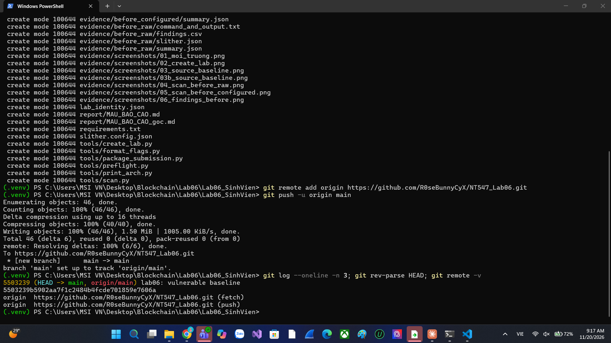

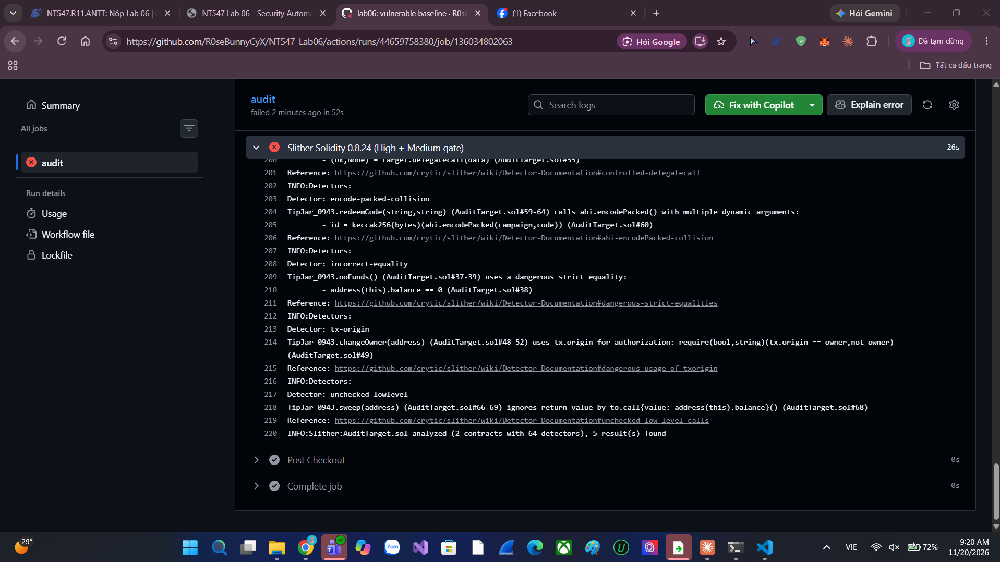

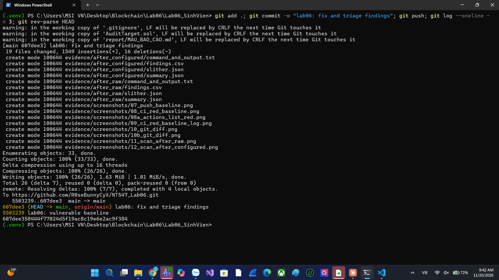

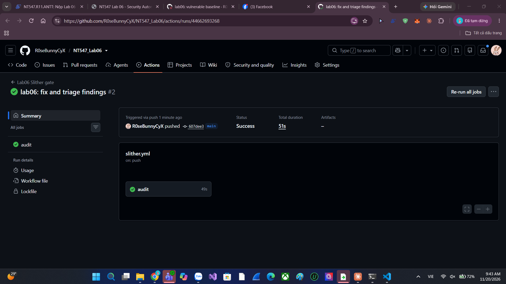

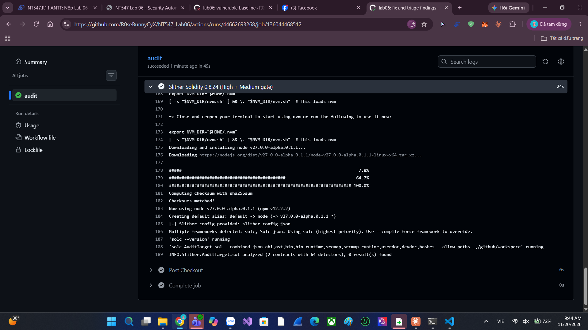

- **Local `--fail-none` vs CI `fail-on: medium`:** ở local, `--fail-none` khiến Slither luôn trả exit code 0 để script lưu đủ JSON/CSV làm bằng chứng, kể cả khi có High. Trên CI, `fail-on: medium` biến kết quả thành quality gate: chỉ cần còn 1 finding Medium hoặc High (sau khi áp config và suppression) thì job fail → commit bị đánh dấu ✗.
- **`exclude_low` / `exclude_informational`:** làm finding Low/Info không xuất hiện trong output configured và CI (raw ____ → configured ____ finding), giảm nhiễu; nhưng không ảnh hưởng High/Medium nên không thể dùng để "ép" GREEN.

---

## 5. Nhiệm vụ 5 – Mutation RED → GREEN (1,5 điểm)

### 5.1. Quan sát: mutation trong `modifier onlyOwner` không bị phát hiện

Thử đổi đúng dòng trong `modifier onlyOwner` như hướng dẫn (`msg.sender` → `tx.origin`) và scan local: `python tools/scan.py --mode configured --tag mutation_modifier` → kết quả `____` finding.

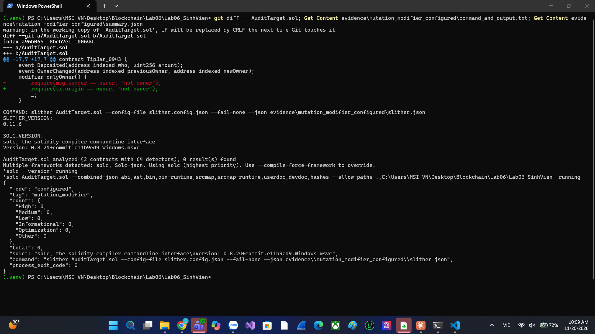

Nguyên nhân: detector `tx-origin` của Slither 0.11.6 (`slither/detectors/statements/tx_origin.py`) chỉ duyệt `contract.functions`, không duyệt modifier, nên điều kiện `tx.origin` trong modifier bị bỏ sót (false negative). Đây là ví dụ cho thấy công cụ tĩnh không thay thế được review thủ công. Thay đổi này **không commit**, đã hoàn tác bằng `git checkout -- AuditTarget.sol`.

### 5.2. Mutation một dòng được commit

- Đổi đúng 1 dòng kiểm tra quyền trong `changeOwner`: `require(msg.sender == owner, "not owner");` → `require(tx.origin == owner, "not owner");`
- Detector kỳ vọng: `tx-origin` (Medium). Xác nhận local: ____; xác nhận CI: ____.

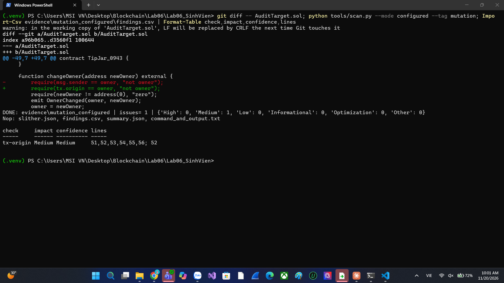

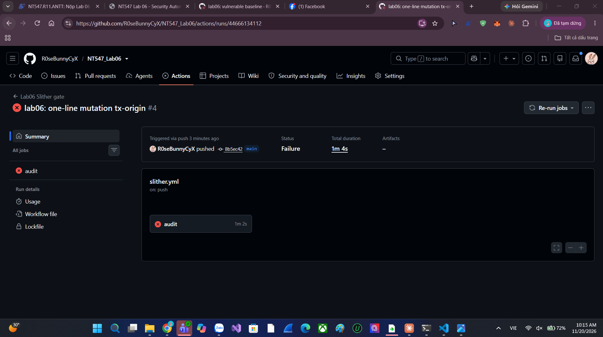

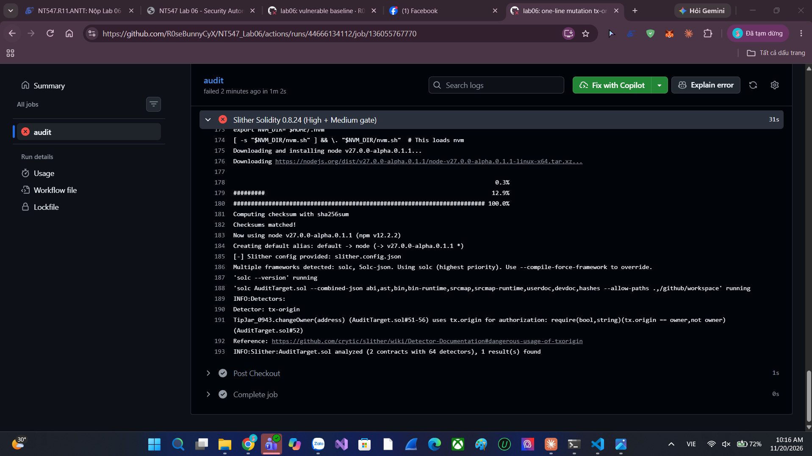

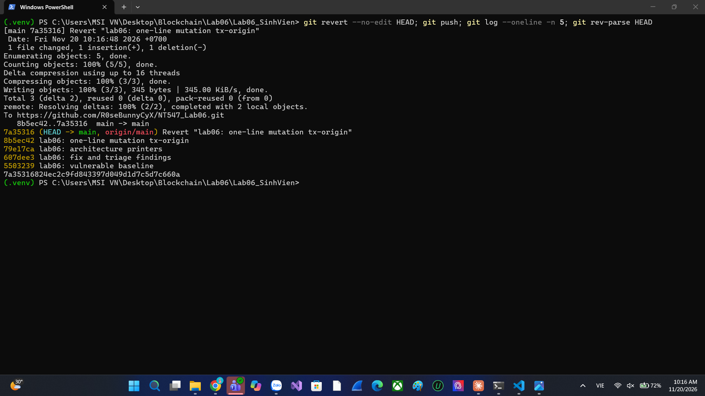

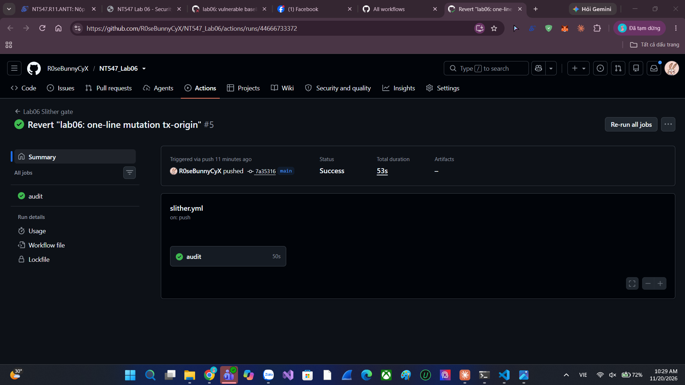

| Phase | Commit SHA | Run URL | Kết quả |
|---|---|---|---|
| Mutation | ____ | ____ | RED (tx-origin) |
| Revert mutation | ____ | ____ | GREEN |

- **Giải thích nguồn định danh:** `msg.sender` là địa chỉ gọi trực tiếp hàm; `tx.origin` là EOA khởi tạo cả giao dịch. Khi dùng `tx.origin`, nếu owner bị dụ tương tác với một contract độc hại, contract đó gọi tiếp `changeOwner(attacker)` vẫn qua được kiểm tra vì `tx.origin` = owner → mất quyền sở hữu. Mutation chỉ 1 dòng đã đủ làm CI đỏ, chứng tỏ quality gate bắt được hồi quy bảo mật; `git revert` đưa code về bản an toàn và CI xanh trở lại.

### 5.3. Toàn bộ chuỗi R → G → R → G

| # | Phase | SHA | Run URL | Kết quả |
|---|---|---|---|---|
| 1 | Baseline | 5503239 | https://github.com/R0seBunnyCyX/NT547_Lab06/actions/runs/44659758380 | RED |
| 2 | Fix | 607dee3 | https://github.com/R0seBunnyCyX/NT547_Lab06/actions/runs/44662693268 | GREEN |
| 3 | Mutation | ____ | ____ | RED |
| 4 | Revert | ____ | ____ | GREEN |

---

## 6. Bằng chứng & tự kiểm

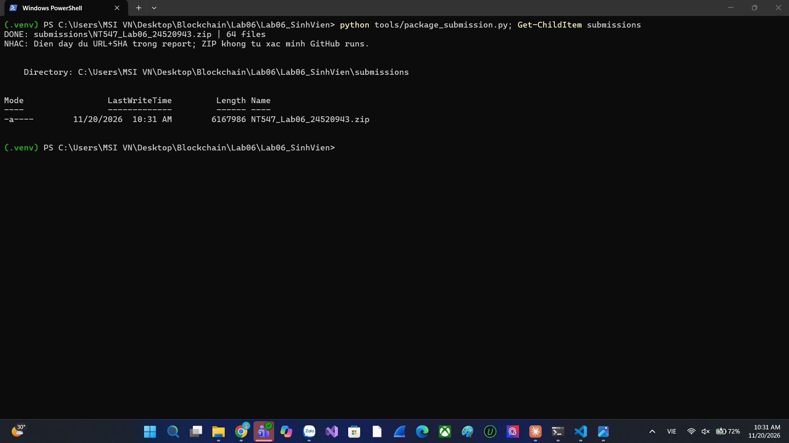

- [ ] `AuditTarget.sol`, `lab_identity.json`
- [ ] `evidence/before_raw/` và `evidence/before_configured/`
- [ ] `evidence/after_raw/` và `evidence/after_configured/`
- [ ] `evidence/architecture/` (human_summary.txt, .dot, inheritance.png)
- [ ] 04 URL Actions run RED/GREEN/RED/GREEN + 04 commit SHA
- [ ] Link repo và ảnh màn hình có terminal / URL / commit SHA; không cắt mất ngữ cảnh
- [ ] Các finding được triage, không chép lại mô tả detector thay cho suy luận
- [ ] Tuyệt đối không có seed phrase, private key, credentials
- [ ] File nộp: `submissions/NT547_Lab06_24520943.zip`

**Nhận xét cuối cùng (5–7 câu):** ____
